# PHU SPICE検証レポート

ケース 26件・判定 80項目：**FAIL 0件、WARN 7件**、PASS 73件

| ケース | 内容 | 判定項目 | 値 | 基準 | 結果 |
|---|---|---|---|---|---|
| tb1a_normal | 通常：ACC ON→マイコン起動→ACC OFF→PC終了30秒→DISCHでOFF | ACC ONから0.1秒以内にリレーON | 0.1088 | < 0.2 | PASS |
|  |  | PC終了中（ACC OFF後）も保持 | 12.47 | > 12 | PASS |
|  |  | DISCHから0.2秒以内にOFF | 40.05 | < 40.2 | PASS |
| tb1b_mcu_dead | マイコンが動かない（ポンプなし）：ACC 10秒 ON→OFF | ハードタイマーで必ず切れる（暗電流ゼロ） | 23.17 | < 70 | PASS |
| tb1c_stuckH | ACC OFF後にマイコンが固まる（ピンH固着） | 固着から60秒以内に切れる | 52.28 | < 75 | PASS |
| tb1d_crank | 始動：ACC 3秒断、+B 4.5V(50ms)→6V、マイコンも3.5秒リセット | クランキング中もリレーを保持（VSW≒+B） | 4.497 | > 4 | PASS |
| tb1e_crank_early | ACC ON 0.5秒後（マイコン起動前）にクランキング | 始動後にACCが戻れば再びON | 3.609 | < 3.8 | PASS |
| tb1f_cap_derated | 保持コンデンサがDCバイアスで4.7uFに減った場合（マイコン故障） | ACC OFF後に2秒以上は保持（瞬断対策） | 20.7 | > 12 | PASS |
| tb2_9V | +B=ACC=9V 定常（リレーON・ポンプ動作） | リレーがONしている | 8.826 | > 8.6 | PASS |
|  |  | TL431のImin（最大1mA） | 0.00132 | > 0.001 | PASS |
|  |  | ZD1 0.5Wの半分以下 | 1.51e-08 | < 0.25 | PASS |
|  |  | R5（1206 0.25W） | 0.008563 | < 0.25 | PASS |
|  |  | Q2のVgs（±20V） | -8.023 | > -15 | PASS |
|  |  | リレーコイル（定格0.4W、最大電圧180%＝1.3W相当の半分） | 0.2117 | < 0.72 | PASS |
|  |  | ADC入力3.3V以下 | 0.8177 | < 3.3 | PASS |
| tb2_12V | +B=ACC=12V 定常（リレーON・ポンプ動作） | リレーがONしている | 11.87 | > 11.6 | PASS |
|  |  | TL431のImin（最大1mA） | 0.002164 | > 0.001 | PASS |
|  |  | ZD1 0.5Wの半分以下 | 2.498e-08 | < 0.25 | PASS |
|  |  | R5（1206 0.25W） | 0.01641 | < 0.25 | PASS |
|  |  | Q2のVgs（±20V） | -10.79 | > -15 | PASS |
|  |  | リレーコイル（定格0.4W、最大電圧180%＝1.3W相当の半分） | 0.3814 | < 0.72 | PASS |
|  |  | ADC入力3.3V以下 | 1.09 | < 3.3 | PASS |
| tb2_14.2V | +B=ACC=14.2V 定常（リレーON・ポンプ動作） | リレーがONしている | 14.09 | > 13.8 | PASS |
|  |  | TL431のImin（最大1mA） | 0.002785 | > 0.001 | PASS |
|  |  | ZD1 0.5Wの半分以下 | 3.349e-08 | < 0.25 | PASS |
|  |  | R5（1206 0.25W） | 0.02379 | < 0.25 | PASS |
|  |  | Q2のVgs（±20V） | -11.67 | > -15 | PASS |
|  |  | リレーコイル（定格0.4W、最大電圧180%＝1.3W相当の半分） | 0.5376 | < 0.72 | PASS |
|  |  | ADC入力3.3V以下 | 1.29 | < 3.3 | PASS |
| tb2_16V | +B=ACC=16V 定常（リレーON・ポンプ動作） | リレーがONしている | 15.9 | > 15.6 | PASS |
|  |  | TL431のImin（最大1mA） | 0.003292 | > 0.001 | PASS |
|  |  | ZD1 0.5Wの半分以下 | 4.12e-08 | < 0.25 | PASS |
|  |  | R5（1206 0.25W） | 0.03085 | < 0.25 | PASS |
|  |  | Q2のVgs（±20V） | -11.74 | > -15 | PASS |
|  |  | リレーコイル（定格0.4W、最大電圧180%＝1.3W相当の半分） | 0.6853 | < 0.72 | PASS |
|  |  | ADC入力3.3V以下 | 1.454 | < 3.3 | PASS |
| tb2_24V | +B=ACC=24V 定常（リレーON・ポンプ動作） | リレーがONしている | 23.93 | > 23.6 | PASS |
|  |  | TL431のImin（最大1mA） | 0.005527 | > 0.001 | PASS |
|  |  | ZD1 0.5Wの半分以下 | 0.003385 | < 0.25 | PASS |
|  |  | R5（1206 0.25W） | 0.07425 | < 0.25 | PASS |
|  |  | Q2のVgs（±20V） | -11.85 | > -15 | PASS |
|  |  | リレーコイル（定格0.4W、最大電圧180%＝1.3W相当の半分） | 1.559 | < 0.72 | WARN |
|  |  | ADC入力3.3V以下 | 2.181 | < 3.3 | PASS |
| tb2_35V | +B=ACC=35V 定常（リレーON・ポンプ動作） | リレーがONしている | 34.94 | > 34.6 | PASS |
|  |  | TL431のImin（最大1mA） | 0.005732 | > 0.001 | PASS |
|  |  | ZD1 0.5Wの半分以下 | 0.1626 | < 0.25 | PASS |
|  |  | R5（1206 0.25W） | 0.3657 | < 0.25 | WARN |
|  |  | Q2のVgs（±20V） | -11.91 | > -15 | PASS |
|  |  | リレーコイル（定格0.4W、最大電圧180%＝1.3W相当の半分） | 3.34 | < 0.72 | WARN |
|  |  | ADC入力3.3V以下 | 3.18 | < 3.3 | PASS |
| tb3a_inrush | リレーが閉じたときの突入電流（電池10mΩ＋配線1µH） | 接点の突入電流（目安80A） | 126.1 | < 80 | WARN |
|  |  | 5Vが立ち上がる | 4.985 | > 4.75 | PASS |
| tb3b_crank | 始動中の5V（+B 4.5V→6V 1秒、ACC断、マイコンはリセット） | リレーを保持 | 4.497 | > 4 | PASS |
|  |  | 5Vが4.4V以上（ハブ・ノードがリセットしない） | -6.723e-11 | > 4.4 | WARN |
|  |  | 始動後に5Vが戻る | 4.985 | > 4.75 | PASS |
| tb3c_iso2a | ISO 7637-2 パルス2a相当（+50V／2Ω／50µs、電池なし） | 40V級の部品の定格以内 | 15.13 | < 45 | PASS |
|  |  | 5Vに影響しない | 4.985 | < 5.5 | PASS |
| tb3d_iso2a_noload | パルス2a・PCモジュールなし（大きな入力コンデンサがない最悪条件） | LM2576HV（63V）以内 | 24.82 | < 60 | PASS |
|  |  | LM2903の電源（36V）以内 | 8.59 | < 30 | PASS |
| tb3e_loaddump | ロードダンプ（抑制後35V・0.2秒、電源側50mΩ） | TVSが導通しない（焼けない） | 1.335e-05 | < 0.05 | PASS |
|  |  | 5V正常 | 4.985 | < 5.25 | PASS |
|  |  | 5V正常 | 4.985 | > 4.75 | PASS |
| tb3f_iso1 | ISO 7637-2 パルス1相当（電源断＋−75V／10Ω／2ms） | LM2576に逆電圧がかからない | 4.449 | > -0.3 | PASS |
|  |  | PC用モジュールにかかる逆電圧 | -0.7033 | > -2 | PASS |
| tb3g_reverse | 逆接 −14V（駐車中に逆につないだ） | リレーが閉じない（VSWに逆電圧が出ない） | -5.608e-07 | > -0.5 | PASS |
|  |  | ACCから流れる電流1mA未満 | 0.0001922 | > -0.001 | PASS |
| tb3h_dark | 暗電流（駐車中：+B 12.6V、ACC線は車両の負荷10Ωで0V） | +Bから1µA未満（リレーの開放抵抗1GΩ分だけ） | -1.26e-08 | > -1e-06 | PASS |
|  |  | ACCから1µA未満 | 1.38e-15 | > -1e-06 | PASS |
| tb4_9V_2A | LM2576（TIのスイッチングモデル）入力9V・2A | 5V（±3%） | 4.988 | > 4.85 | PASS |
|  |  | リップル100mV以下 | 0.01708 | < 0.1 | PASS |
| tb4_14.2V_2A | LM2576（TIのスイッチングモデル）入力14.2V・2A | 5V（±3%） | 5.005 | > 4.85 | PASS |
|  |  | リップル100mV以下 | 0.02801 | < 0.1 | PASS |
| tb4_24V_2A | LM2576（TIのスイッチングモデル）入力24V・2A | 5V（±3%） | 5.017 | > 4.85 | PASS |
|  |  | リップル100mV以下 | 0.04383 | < 0.1 | PASS |
| tb4_35V_2A | LM2576（TIのスイッチングモデル）入力35V・2A | 5V（±3%） | 5.025 | > 4.85 | PASS |
|  |  | リップル100mV以下 | 0.04802 | < 0.1 | PASS |
| tb4_24V_3A | LM2576（TIのスイッチングモデル）入力24V・3A | 5V（±3%） | 4.515 | > 4.85 | WARN |
|  |  | リップル100mV以下 | 0.3817 | < 0.1 | WARN |
| tb5_uvlo | LM2576の低電圧停止（入力 0→12→0V） | 7V以下で起動 | 6.269 | < 7 | PASS |
|  |  | クランキング（6V）では止まらない | 4.077 | < 5 | PASS |

## 測定値（全項目）

- **tb1a_normal**（132.4秒）：t_on=0.1088、t_off=40.05、vsw_hold=12.47
- **tb1b_mcu_dead**（22.6秒）：t_off=23.17
- **tb1c_stuckH**（68.8秒）：t_off=52.28
- **tb1d_crank**（48.6秒）：vsw_min=4.497、hn_min=5.839
- **tb1e_crank_early**（6.5秒）：t_drop=0.6298、t_re=3.609
- **tb1f_cap_derated**（63.9秒）：t_off=20.7
- **tb2_9V**（1.9秒）：vsw=8.826、vcmp=5.399、i431=0.00132、pz1=1.51e-08、pr5=0.008563、vgs2=-8.023、icoil=0.02425、pcoil=0.2117、hn=3.397、adc0=0.8177
- **tb2_12V**（1.8秒）：vsw=11.87、vcmp=7.257、i431=0.002164、pz1=2.498e-08、pr5=0.01641、vgs2=-10.79、icoil=0.03255、pcoil=0.3814、hn=4.825、adc0=1.09
- **tb2_14.2V**（1.8秒）：vsw=14.09、vcmp=8.621、i431=0.002785、pz1=3.349e-08、pr5=0.02379、vgs2=-11.67、icoil=0.03864、pcoil=0.5376、hn=5.877、adc0=1.29
- **tb2_16V**（1.8秒）：vsw=15.9、vcmp=9.738、i431=0.003292、pz1=4.12e-08、pr5=0.03085、vgs2=-11.74、icoil=0.04363、pcoil=0.6853、hn=6.739、adc0=1.454
- **tb2_24V**（1.7秒）：vsw=23.93、vcmp=14.66、i431=0.005527、pz1=0.003385、pr5=0.07425、vgs2=-11.85、icoil=0.06581、pcoil=1.559、hn=10.56、adc0=2.181
- **tb2_35V**（1.6秒）：vsw=34.94、vcmp=15.11、i431=0.005732、pz1=0.1626、pr5=0.3657、vgs2=-11.91、icoil=0.09632、pcoil=3.34、hn=11.08、adc0=3.18
- **tb3a_inrush**（0.8秒）：ipk=126.1、i2t=2.055、v5end=4.985
- **tb3b_crank**（2.5秒）：v5min=-6.723e-11、vswmin=4.497、v5end=4.985
- **tb3c_iso2a**（3.6秒）：vswmax=15.13、itvs=0.004651、v5max=4.985
- **tb3d_iso2a_noload**（3.9秒）：vswmax=24.82、vin5max=23.42、itvs=0.005473、vcmpmax=8.59
- **tb3e_loaddump**（2.0秒）：vswmax=34.78、itvs=1.335e-05、v5max=4.985、v5min=4.985、vcmpmax=15.1
- **tb3f_iso1**（0.8秒）：vswmin=-0.7033、vin5min=4.449、itvsmin=-1.567
- **tb3g_reverse**（0.2秒）：ibat=1.4e-08、iacc=0.0001922、vsw=-5.608e-07
- **tb3h_dark**（0.5秒）：ibat=-1.26e-08、iacc=1.38e-15、vsw=5e-07
- **tb4_9V_2A**（11.8秒）：v5avg=4.988、v5pp=0.01708、iin=—
- **tb4_14.2V_2A**（11.3秒）：v5avg=5.005、v5pp=0.02801、iin=—
- **tb4_24V_2A**（11.3秒）：v5avg=5.017、v5pp=0.04383、iin=—
- **tb4_35V_2A**（12.6秒）：v5avg=5.025、v5pp=0.04802、iin=—
- **tb4_24V_3A**（11.3秒）：v5avg=4.515、v5pp=0.3817、iin=—
- **tb5_uvlo**（33.9秒）：vin_on=6.269、vin_off=4.077

## 波形

### tb1a_normal
通常：ACC ON→マイコン起動→ACC OFF→PC終了30秒→DISCHでOFF

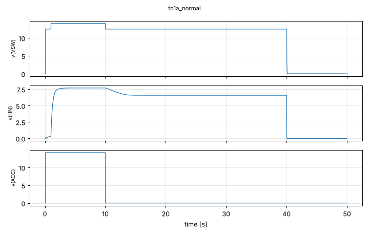

### tb1b_mcu_dead
マイコンが動かない（ポンプなし）：ACC 10秒 ON→OFF

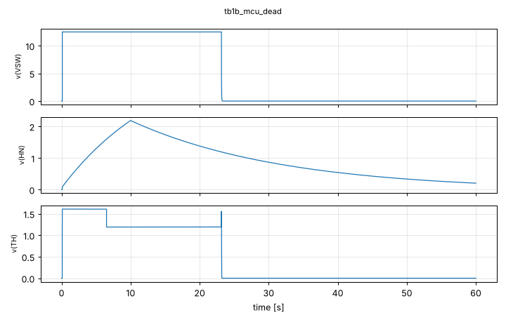

### tb1c_stuckH
ACC OFF後にマイコンが固まる（ピンH固着）

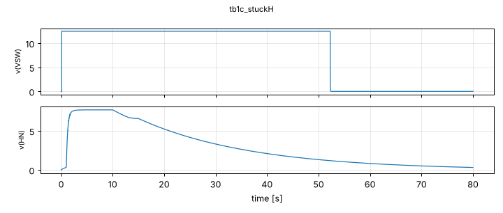

### tb1d_crank
始動：ACC 3秒断、+B 4.5V(50ms)→6V、マイコンも3.5秒リセット

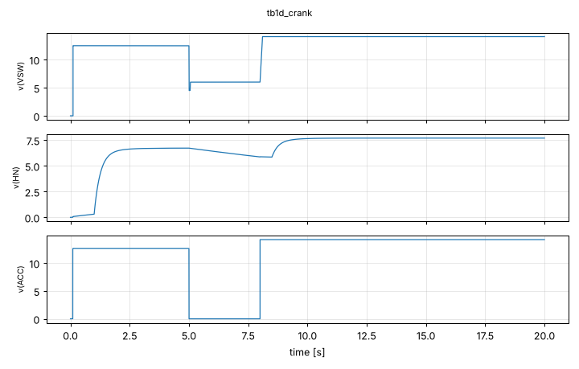

### tb1e_crank_early
ACC ON 0.5秒後（マイコン起動前）にクランキング

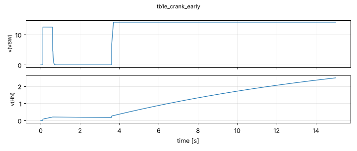

### tb1f_cap_derated
保持コンデンサがDCバイアスで4.7uFに減った場合（マイコン故障）

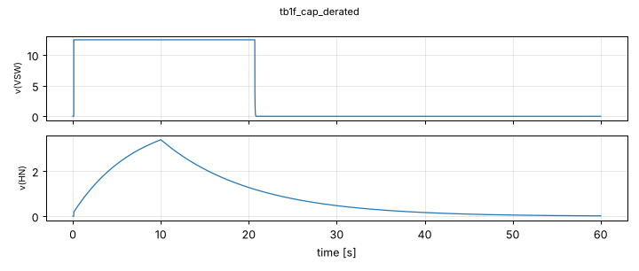

### tb3a_inrush
リレーが閉じたときの突入電流（電池10mΩ＋配線1µH）

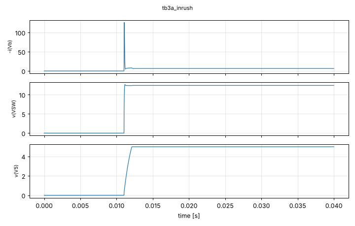

### tb3b_crank
始動中の5V（+B 4.5V→6V 1秒、ACC断、マイコンはリセット）

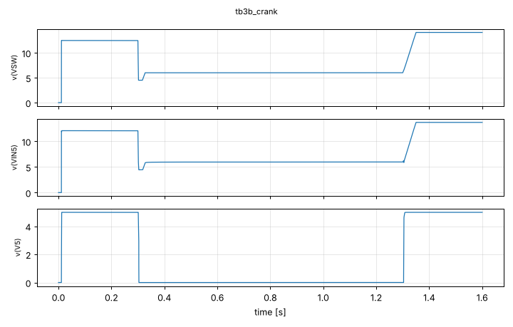

### tb3c_iso2a
ISO 7637-2 パルス2a相当（+50V／2Ω／50µs、電池なし）

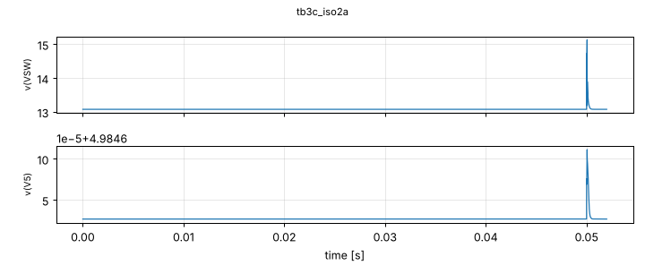

### tb3d_iso2a_noload
パルス2a・PCモジュールなし（大きな入力コンデンサがない最悪条件）

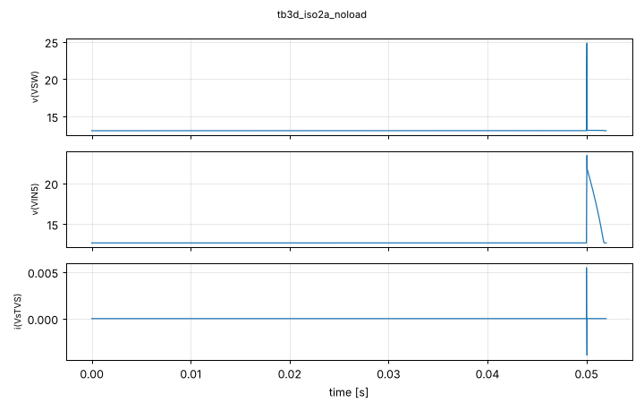

### tb3e_loaddump
ロードダンプ（抑制後35V・0.2秒、電源側50mΩ）

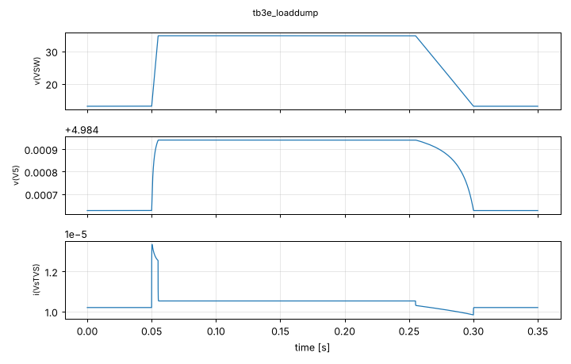

### tb3f_iso1
ISO 7637-2 パルス1相当（電源断＋−75V／10Ω／2ms）

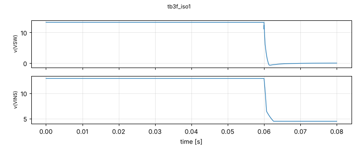

### tb4_9V_2A
LM2576（TIのスイッチングモデル）入力9V・2A

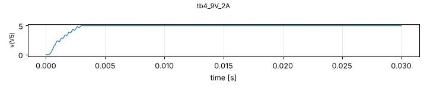

### tb4_14.2V_2A
LM2576（TIのスイッチングモデル）入力14.2V・2A

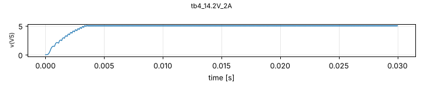

### tb4_24V_2A
LM2576（TIのスイッチングモデル）入力24V・2A

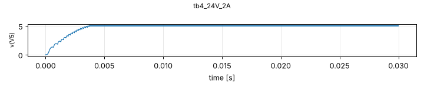

### tb4_35V_2A
LM2576（TIのスイッチングモデル）入力35V・2A

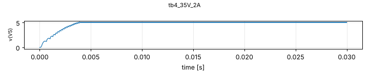

### tb4_24V_3A
LM2576（TIのスイッチングモデル）入力24V・3A

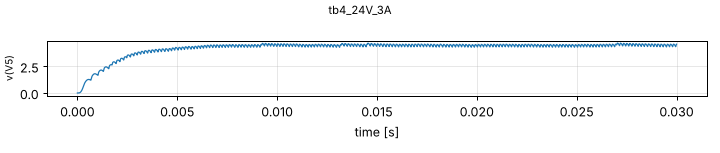

### tb5_uvlo
LM2576の低電圧停止（入力 0→12→0V）

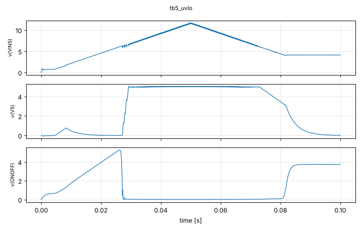
