# PWR-CTRL v1.0 SPICE report
2026-11-10 10:13  ngspice: /usr/bin/ngspice

**FAIL 0 / WARN 5 / checks 79**
## tb1_nominal  (tb1_power_sequence.cir)
Power sequence: ACC on -> crank -> ACC off -> MCU HOLD=L at 12 s

| check | value | limit | result | note |
|---|---|---|---|---|
| `t_relay_on-1` | 0.5189 | < 1 | **PASS** | ACCだけで1秒以内にリレーが入る [s]（通常はマイコンが先にHOLD=Hにする） |
| `vsw_min_crank` | 6.576 | > 6 | **PASS** | クランキング中のVSWがDFR0946の最低入力6V以上 [V] |
| `v5_min_crank` | 4.786 | > 4.5 | **PASS** | クランキング中の+5V（XIAOの5V入力） [V] |
| `v3_min_all` | 3.294 | > 3 | **PASS** | 動作中に3V3が下がらない [V] |
| `t_relay_off-12` | 0.03615 | < 0.2 | **PASS** | HOLD=Lから0.2秒以内にリレーが切れる [s] |
| `ibat_peak` | 83.43 | < 200 | **PASS** | リレーが閉じたときの突入電流 [A]（tb5で詳しく確認） |

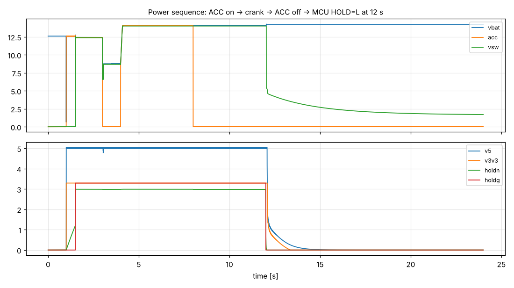

## tb1_mcufail  (tb1_power_sequence.cir)
Same, but the MCU pin goes Hi-Z at 12 s (crash): HOLD_N RC must release the relay

| check | value | limit | result | note |
|---|---|---|---|---|
| `t_relay_off-12` | 7.89 | > 2 | **PASS** | Hi-Z後の保持時間が2秒以上（マイコンのリセットに足りる） [s] |
| `t_relay_off-12` | 7.89 | < 30 | **PASS** | 30秒以内にリレーが切れる（暗電流ゼロ） [s] |

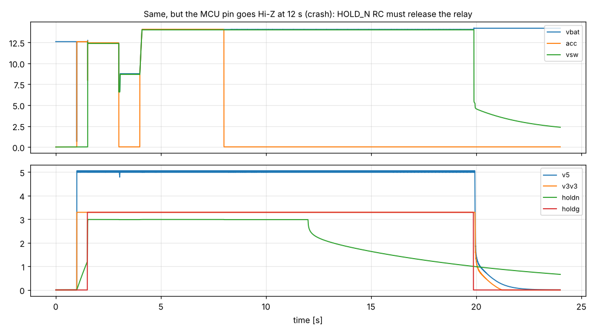

## tb2_sweep  (tb2_supply_sweep.cir)
Slow supply sweep 0->30->0 V (MCU Hi-Z): ADC scaling, relay pull-in, jump start

| check | value | limit | result | note |
|---|---|---|---|---|
| `accs_max` | 2.818 | < 3.3 | **PASS** | ACC_SENSEが3.3V（ESP32の上限）を超えない [V] |
| `abs(accs_at12/(12/ACCDIV)-1)` | 0.0005331 | < 0.03 | **PASS** | 12VでのACC_SENSEの誤差が3%未満 |
| `abs(accs_at16/(16/ACCDIV)-1)` | 0.002085 | < 0.03 | **PASS** | 16VでのACC_SENSEの誤差が3%未満（ZD2の漏れ） |
| `v_relay_in` | 9.9 | < 10.5 | **PASS** | 電源10.5V未満でリレーが入る [V] |
| `v5_ok_in` | 6.451 | < 7 | **PASS** | 電源7V未満で+5Vが4.75V以上になる [V] |
| `i_tvs1_24v` | 16.77 | < 1 | **WARN** | 24VジャンプスタートでのTVS1の電流 [A] |
| `i_tvs2_24v` | 1.176 | < 0.1 | **WARN** | 24VジャンプスタートでのTVS2の電流 [A] |

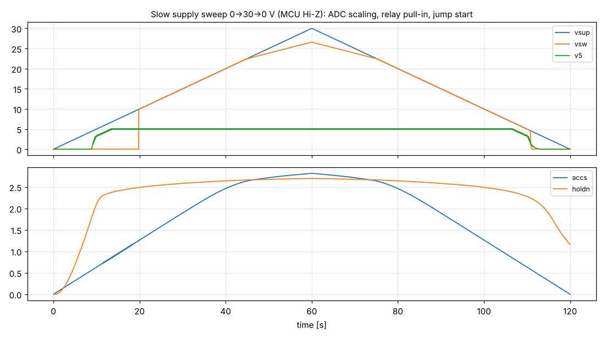

## tb3_tja_only  (tb3_kline.cir)
K-line, JP6 only (TJA1021): fast init / 10400 bps / 5-baud start bit

| check | value | limit | result | note |
|---|---|---|---|---|
| `k_idle` | 13.8 | > 11.04 | **PASS** | 待機中のK-LineがVBATの80%以上 [V] |
| `k_fast_low` | 1.423 | < 2.76 | **PASS** | ファスト初期化のLがVBATの20%以下（ISO 14230） [V] |
| `k_bit_late` | 13.8 | < 2.76 | **WARN** | 5ボー初期化の200msの間Lを保つ [V]（TJA1021は約27msで解除されるため、想定どおり満たさない） |

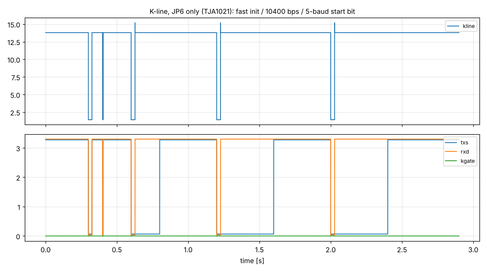

## tb3_parallel  (tb3_kline.cir)
K-line, JP6 + JP7 (parallel drive with Q9)

| check | value | limit | result | note |
|---|---|---|---|---|
| `k_idle` | 13.8 | > 11.04 | **PASS** | 待機中のK-LineがVBATの80%以上 [V] |
| `k_fast_low` | 0.1812 | < 2.76 | **PASS** | ファスト初期化のLがVBATの20%以下 [V] |
| `k_bit_late` | 0.2047 | < 2.76 | **PASS** | 5ボー初期化の200msの間Lを保つ [V] |
| `rxd_bit_late` | 0.03474 | < 0.5 | **PASS** | RXDがLを受信する（エコー） [V] |
| `p_r14_low` | 0.3239 | < 0.5 | **PASS** | K-LineがLの間のR14（1W品）の消費電力 [W] |

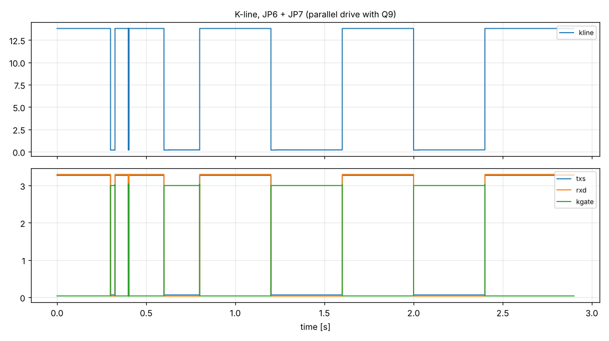

## tb4_5b_35V  (tb4_load_dump.cir)
Load dump, suppressed (alternator clamps at 35 V), Ri 1 ohm, td 200 ms

| check | value | limit | result | note |
|---|---|---|---|---|
| `vsw_peak` | 22.85 | < 35 | **PASS** | VSWがDFR0946の上限35V未満 [V] |
| `acc_peak` | 22.93 | < 40 | **PASS** | ACCが40V未満 [V] |
| `v5_min` | 4.994 | > 4.5 | **PASS** | +5Vが止まらない [V] |
| `e_tvs1_total` | 57.18 | < 75 | **PASS** | TVS1が吸収するエネルギー [J]（SM8S20Aの目安 約75J） |
| `p_tvs2_peak` | 14.69 | < 40 | **PASS** | TVS2 SMAJ20Aのピーク電力 [W]（約200msのパルス） |

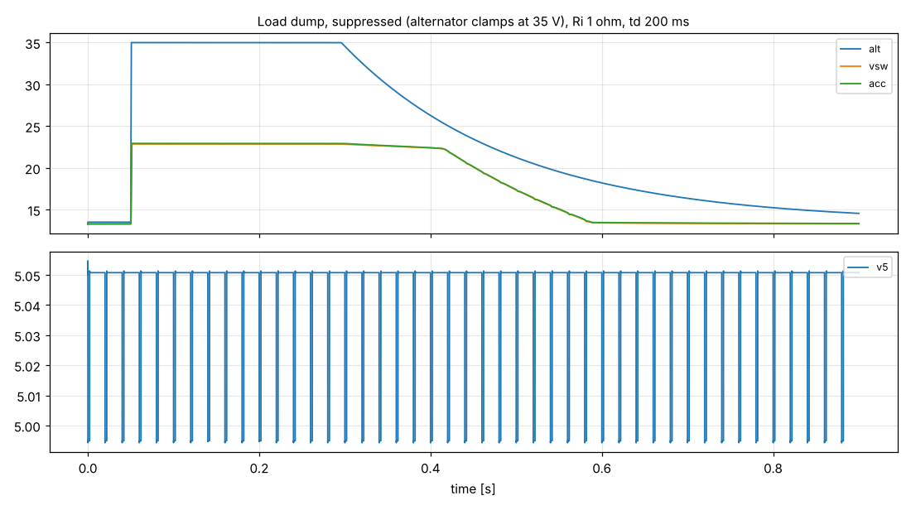

## tb4_5a_87V_1R  (tb4_load_dump.cir)
Load dump, unsuppressed 87 V, Ri 1 ohm (severe ISO 16750-2 test A)

| check | value | limit | result | note |
|---|---|---|---|---|
| `vsw_peak` | 25.04 | < 35 | **PASS** | VSWがDFR0946の上限35V未満 [V] |
| `e_tvs1_total` | 166.5 | < 75 | **WARN** | TVS1が吸収するエネルギー [J] |
| `p_tvs2_peak` | 90.27 | < 40 | **WARN** | TVS2のピーク電力 [W] |

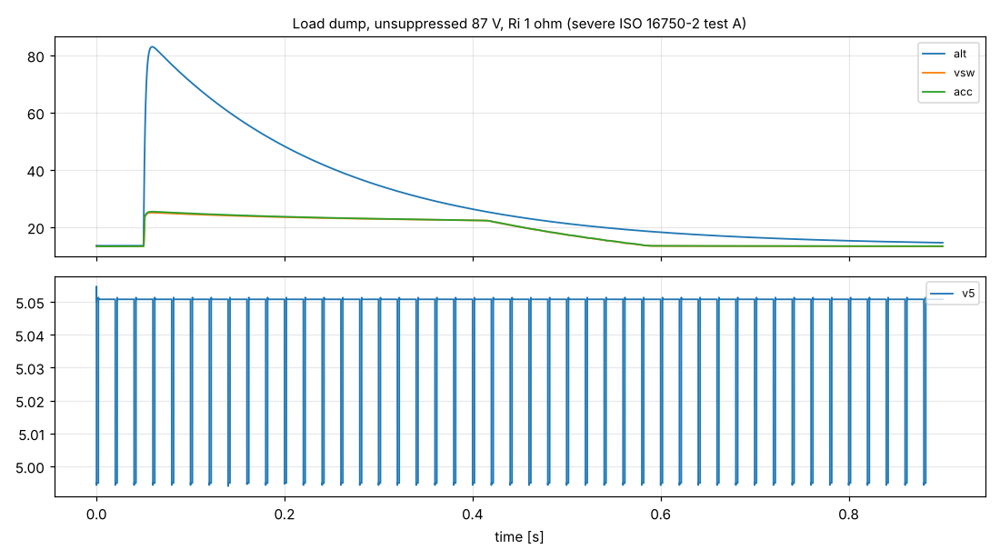

## tb4_5a_87V_4R  (tb4_load_dump.cir)
Load dump, unsuppressed 87 V, Ri 4 ohm (mild test A)

| check | value | limit | result | note |
|---|---|---|---|---|
| `vsw_peak` | 23 | < 35 | **PASS** | VSWがDFR0946の上限35V未満 [V] |
| `e_tvs1_total` | 26.41 | < 75 | **PASS** | TVS1が吸収するエネルギー [J] |
| `p_tvs2_peak` | 19.15 | < 40 | **PASS** | TVS2のピーク電力 [W] |

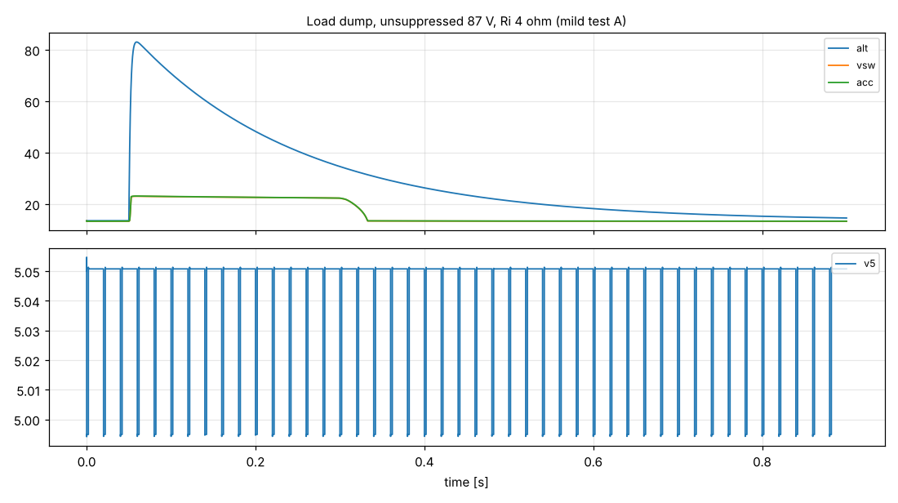

## tb5_inrush  (tb5_inrush.cir)
Relay-close inrush into C1-C3 + DFR0946 input capacitors

| check | value | limit | result | note |
|---|---|---|---|---|
| `i_peak` | 74.89 | < 150 | **PASS** | 接点電流のピーク [A] |
| `i2t_total` | 0.8689 | < 5 | **PASS** | I²t [A²s]（7.5Aヒューズの溶断は約20A²s） |

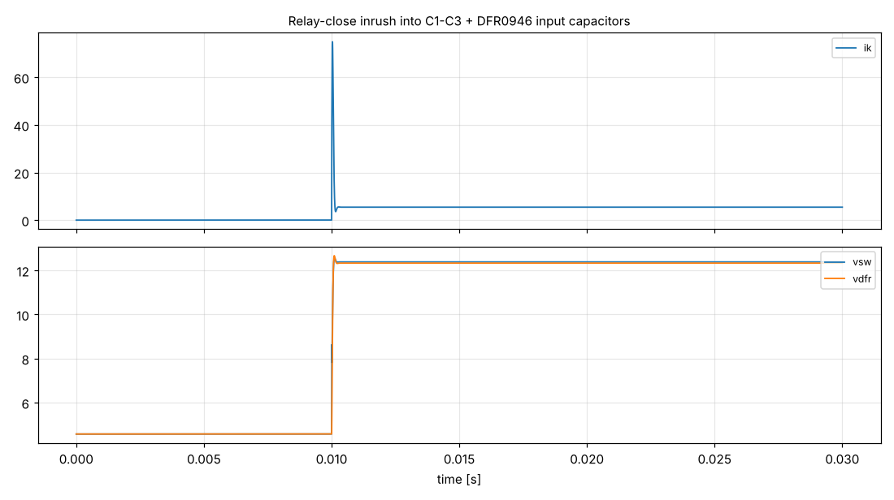

## tb6_nom  (tb6_hold_time.cir)
Hold time after Hi-Z: C11=10u R2=1Meg VT-=1.0 V zener=DZ3V6

| check | value | limit | result | note |
|---|---|---|---|---|
| `hold_s` | 7.884 | > 2 | **PASS** | 保持時間が2秒以上（マイコンのリセットに足りる） [s] |
| `hold_s` | 7.884 | > 3 | **PASS** | 保持時間がwdt_timeout_ms（3000ms）より長い（ファーム仕様） [s] |
| `hold_s` | 7.884 | < 30 | **PASS** | 30秒以内にリレーが切れる（暗電流ゼロ） [s] |

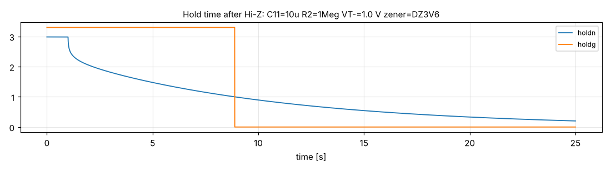

## tb6_sharpZ  (tb6_hold_time.cir)
Hold time after Hi-Z: C11=10u R2=1Meg VT-=1.0 V zener=DZ3V6_SHARP

| check | value | limit | result | note |
|---|---|---|---|---|
| `hold_s` | 11.66 | > 2 | **PASS** | 保持時間が2秒以上（マイコンのリセットに足りる） [s] |
| `hold_s` | 11.66 | > 3 | **PASS** | 保持時間がwdt_timeout_ms（3000ms）より長い（ファーム仕様） [s] |
| `hold_s` | 11.66 | < 30 | **PASS** | 30秒以内にリレーが切れる（暗電流ゼロ） [s] |

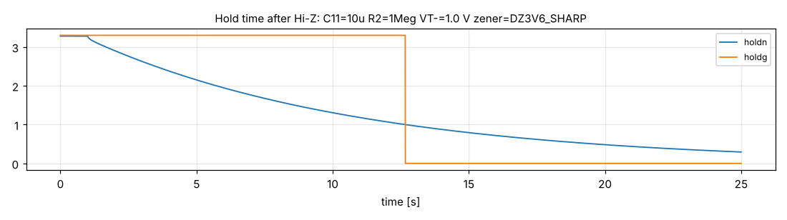

## tb6_worst  (tb6_hold_time.cir)
Hold time after Hi-Z: C11=8u R2=0.95Meg VT-=1.2 V zener=DZ3V6

| check | value | limit | result | note |
|---|---|---|---|---|
| `hold_s` | 4.634 | > 2 | **PASS** | 保持時間が2秒以上（マイコンのリセットに足りる） [s] |
| `hold_s` | 4.634 | > 3 | **PASS** | 保持時間がwdt_timeout_ms（3000ms）より長い（ファーム仕様） [s] |
| `hold_s` | 4.634 | < 30 | **PASS** | 30秒以内にリレーが切れる（暗電流ゼロ） [s] |

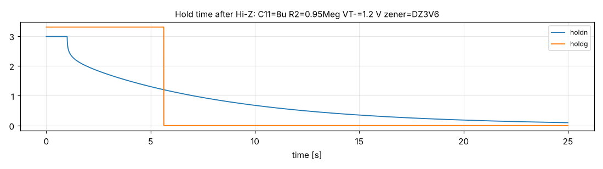

## tb6_best  (tb6_hold_time.cir)
Hold time after Hi-Z: C11=12u R2=1.05Meg VT-=0.8 V zener=DZ3V6_SHARP

| check | value | limit | result | note |
|---|---|---|---|---|
| `hold_s` | 17.51 | > 2 | **PASS** | 保持時間が2秒以上（マイコンのリセットに足りる） [s] |
| `hold_s` | 17.51 | > 3 | **PASS** | 保持時間がwdt_timeout_ms（3000ms）より長い（ファーム仕様） [s] |
| `hold_s` | 17.51 | < 30 | **PASS** | 30秒以内にリレーが切れる（暗電流ゼロ） [s] |

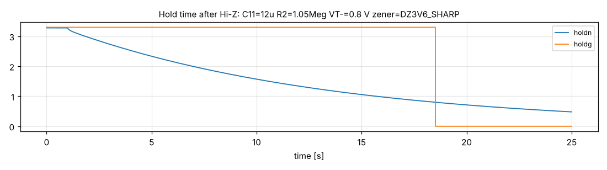

## tb7_speed12  (tb7_pulse_in.cir)
12V方形波・Lが0.8V浮く（車速パルス想定）200Hz

| check | value | limit | result | note |
|---|---|---|---|---|
| `abs(f_out/200-1)` | 0 | < 0.01 | **PASS** | 出力の周波数が入力（200Hz）と一致（パルスの抜け・余分なし） |
| `duty` | 0.5462 | > 0.3 | **PASS** | デューティ比 30%以上 |
| `duty` | 0.5462 | < 0.7 | **PASS** | デューティ比 70%以下 |
| `out_hi` | 3.33 | > 3 | **PASS** | 出力のH電圧 [V] |
| `siga_max` | 4.575 | < 5.5 | **PASS** | U1入力の最大電圧 [V]（74LVC1G17の推奨上限5.5V） |

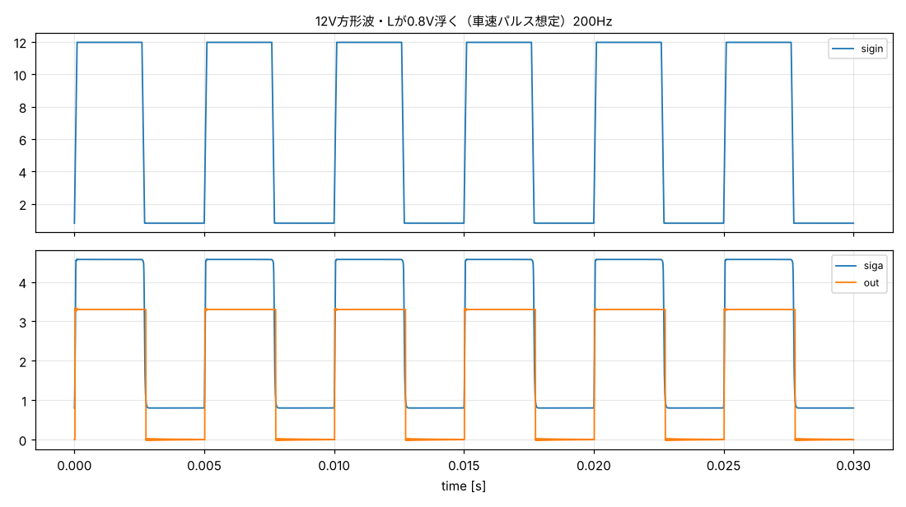

## tb7_tach12_jp2  (tb7_pulse_in.cir)
12V方形波・JP2（12Vしきい値）あり（タコ信号想定）300Hz

| check | value | limit | result | note |
|---|---|---|---|---|
| `abs(f_out/300-1)` | 6.667e-07 | < 0.01 | **PASS** | 出力の周波数が入力（300Hz）と一致（パルスの抜け・余分なし） |
| `duty` | 0.5268 | > 0.3 | **PASS** | デューティ比 30%以上 |
| `duty` | 0.5268 | < 0.7 | **PASS** | デューティ比 70%以下 |
| `out_hi` | 3.351 | > 3 | **PASS** | 出力のH電圧 [V] |
| `siga_max` | 3.738 | < 5.5 | **PASS** | U1入力の最大電圧 [V]（74LVC1G17の推奨上限5.5V） |

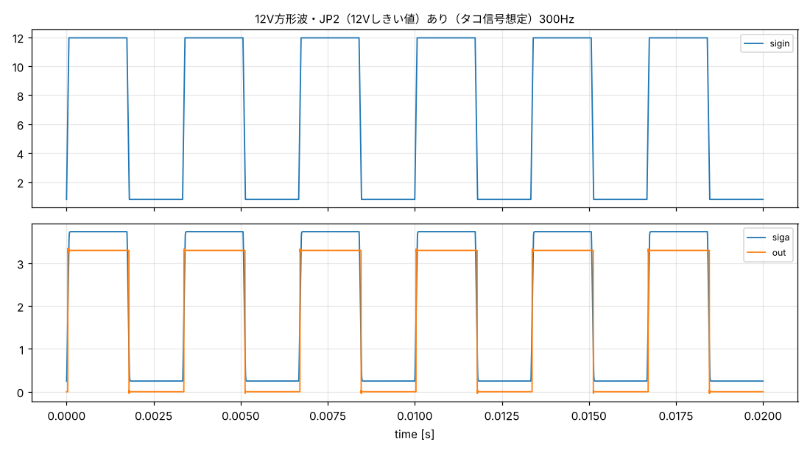

## tb7_oc5  (tb7_pulse_in.cir)
オープンコレクタ・5Vプルアップ 200Hz

| check | value | limit | result | note |
|---|---|---|---|---|
| `abs(f_out/200-1)` | 0 | < 0.01 | **PASS** | 出力の周波数が入力（200Hz）と一致（パルスの抜け・余分なし） |
| `duty` | 0.5244 | > 0.3 | **PASS** | デューティ比 30%以上 |
| `duty` | 0.5244 | < 0.7 | **PASS** | デューティ比 70%以下 |
| `out_hi` | 3.411 | > 3 | **PASS** | 出力のH電圧 [V] |
| `siga_max` | 4.473 | < 5.5 | **PASS** | U1入力の最大電圧 [V]（74LVC1G17の推奨上限5.5V） |

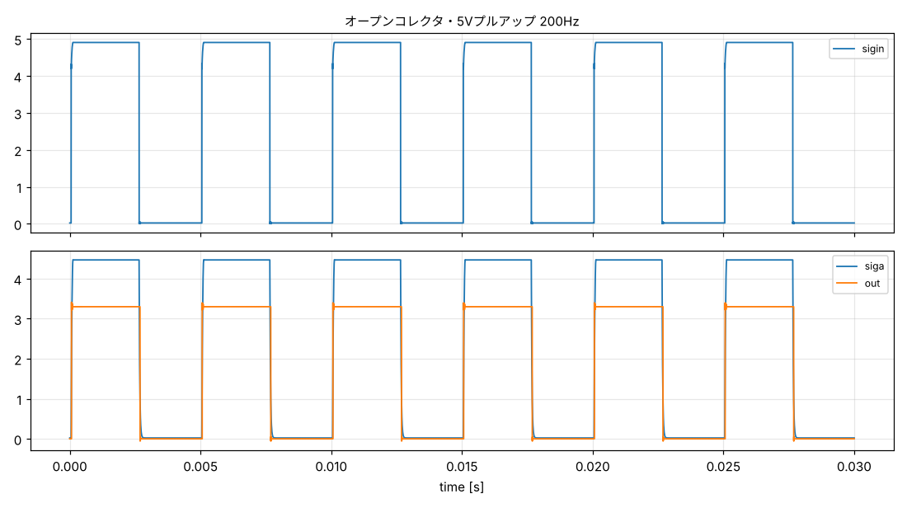

## tb7_oc12_jp2  (tb7_pulse_in.cir)
オープンコレクタ・12Vプルアップ・JP2あり 200Hz

| check | value | limit | result | note |
|---|---|---|---|---|
| `abs(f_out/200-1)` | 0 | < 0.01 | **PASS** | 出力の周波数が入力（200Hz）と一致（パルスの抜け・余分なし） |
| `duty` | 0.5203 | > 0.3 | **PASS** | デューティ比 30%以上 |
| `duty` | 0.5203 | < 0.7 | **PASS** | デューティ比 70%以下 |
| `out_hi` | 3.484 | > 3 | **PASS** | 出力のH電圧 [V] |
| `siga_max` | 3.27 | < 5.5 | **PASS** | U1入力の最大電圧 [V]（74LVC1G17の推奨上限5.5V） |

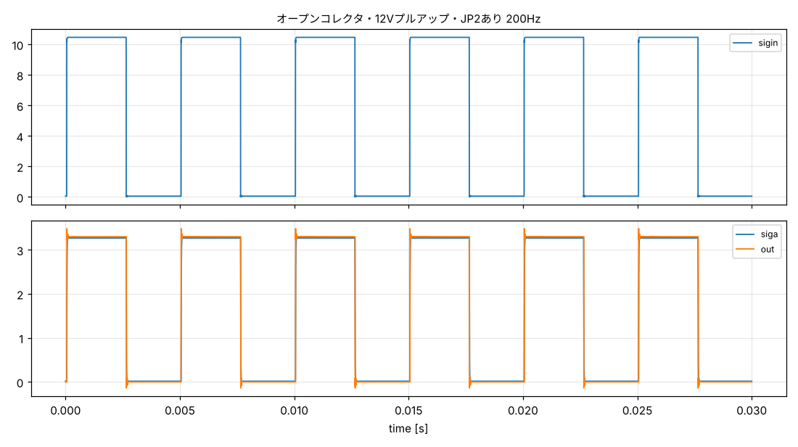

## tb7_sensor3v3  (tb7_pulse_in.cir)
3.3Vセンサー 5kHz

| check | value | limit | result | note |
|---|---|---|---|---|
| `abs(f_out/5000-1)` | 0 | < 0.01 | **PASS** | 出力の周波数が入力（5000Hz）と一致（パルスの抜け・余分なし） |
| `duty` | 0.5671 | > 0.3 | **PASS** | デューティ比 30%以上 |
| `duty` | 0.5671 | < 0.7 | **PASS** | デューティ比 70%以下 |
| `out_hi` | 3.476 | > 3 | **PASS** | 出力のH電圧 [V] |
| `siga_max` | 3.259 | < 5.5 | **PASS** | U1入力の最大電圧 [V]（74LVC1G17の推奨上限5.5V） |

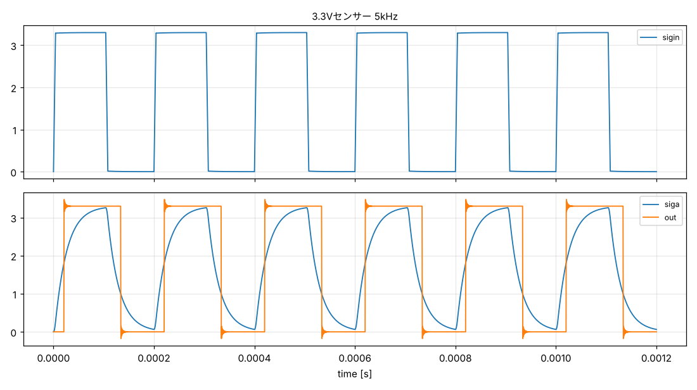

## tb7_spike  (tb7_pulse_in.cir)
12V方形波＋40Vスパイク

| check | value | limit | result | note |
|---|---|---|---|---|
| `abs(f_out/200-1)` | 0 | < 0.01 | **PASS** | 出力の周波数が入力（200Hz）と一致（パルスの抜け・余分なし） |
| `duty` | 0.5462 | > 0.3 | **PASS** | デューティ比 30%以上 |
| `duty` | 0.5462 | < 0.7 | **PASS** | デューティ比 70%以下 |
| `out_hi` | 3.33 | > 3 | **PASS** | 出力のH電圧 [V] |
| `siga_max` | 4.642 | < 5.5 | **PASS** | U1入力の最大電圧 [V]（74LVC1G17の推奨上限5.5V） |

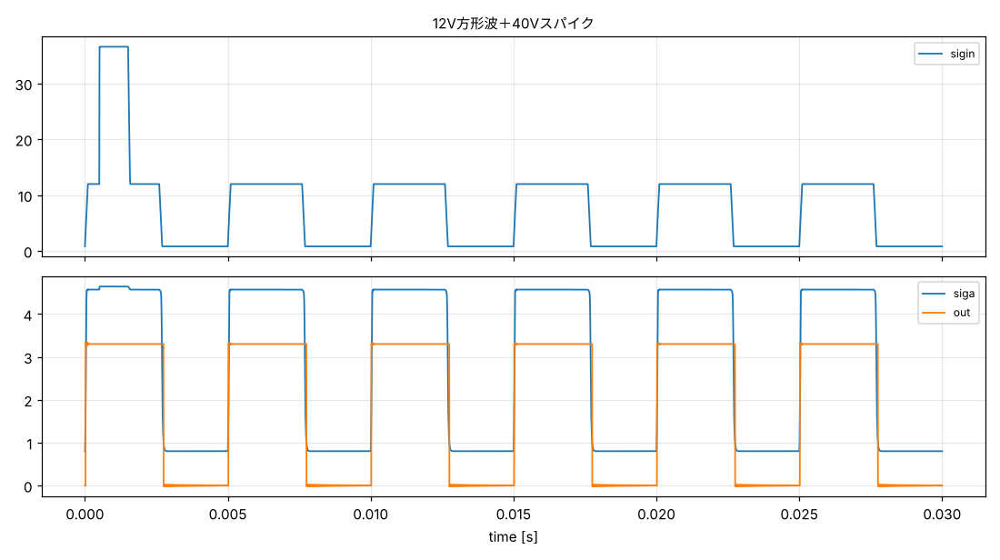

## tb7_5v_jp2_ng  (tb7_pulse_in.cir)
5V信号でJP2を閉じた場合（使えない組み合わせの確認）

```
Error: measure  t_a  when(WHEN) : out of interval
Error: measure  t_b  when(WHEN) : out of interval
Error: measure  t_c  when(WHEN) : out of interval
Error: RHS "1/(t_b - t_a)" invalid
Error: RHS "(t_c - t_a)/(t_b - t_a)" invalid
```
| check | value | limit | result | note |
|---|---|---|---|---|
| `out_hi` | 8.25e-07 | < 0.5 | **PASS** | 出力が変化しない [V]（5V信号ではJP2を閉じないこと） |

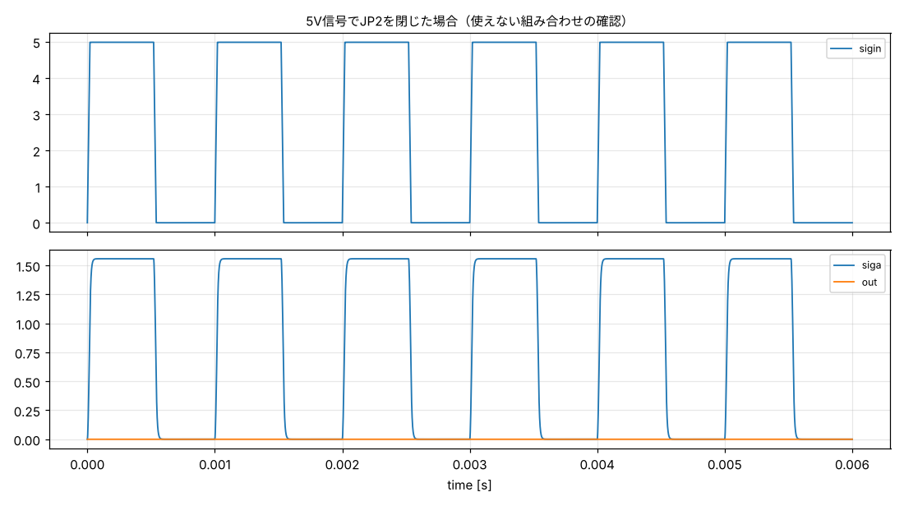
