# PWR-CTRL v2.4.1 SPICE report
2026-11-11 11:27  ngspice: /usr/bin/ngspice

**FAIL 0 / WARN 9 / checks 161**
## tb1_nominal  (tb1_power_sequence.cir)
Power sequence: ACC on -> crank -> ACC off -> MCU HOLD=L at 12 s

| check | value | limit | result | note |
|---|---|---|---|---|
| `t_relay_on-1` | 0.5189 | < 1 | **PASS** | ACCだけで1秒以内にリレーが入る [s]（通常はマイコンが先にHOLD=Hにする） |
| `vsw_min_crank` | 6.552 | > 6 | **PASS** | クランキング中のVSWがDFR0946の最低入力6V以上 [V] |
| `v5_min_crank` | 4.76 | > 4.5 | **PASS** | クランキング中の+5V（XIAOの5V入力） [V] |
| `v3_min_all` | 3.294 | > 3 | **PASS** | 動作中に3V3が下がらない [V] |
| `t_relay_off-12` | 0.03616 | < 0.2 | **PASS** | HOLD=Lから0.2秒以内にリレーが切れる [s] |
| `ibat_peak` | 134.3 | < 200 | **PASS** | リレーが閉じたときの突入電流 [A]（tb5で詳しく確認） |
| `abs(v5s_on-5.3)` | 0.03203 | < 0.15 | **PASS** | +5VS（センサー用5V）が5.3V±0.15V |
| `v5s_min_crank` | 5.227 | > 4.75 | **PASS** | クランキング中の+5VS [V] |
| `v3s_min_crank` | 3.282 | > 3.135 | **PASS** | クランキング中の+3V3S（3.3V−5%以上） [V] |


## tb1_mcufail  (tb1_power_sequence.cir)
Same, but the MCU pin goes Hi-Z at 12 s (crash): HOLD_N RC must release the relay

| check | value | limit | result | note |
|---|---|---|---|---|
| `t_relay_off-12` | 7.891 | > 2 | **PASS** | Hi-Z後の保持時間が2秒以上（マイコンのリセットに足りる） [s] |
| `t_relay_off-12` | 7.891 | < 30 | **PASS** | 30秒以内にリレーが切れる（暗電流ゼロ） [s] |


## tb2_sweep  (tb2_supply_sweep.cir)
Slow supply sweep 0->30->0 V (MCU Hi-Z): ADC scaling, relay pull-in, jump start

| check | value | limit | result | note |
|---|---|---|---|---|
| `accs_max` | 2.817 | < 3.3 | **PASS** | ACC_SENSEが3.3V（ESP32の上限）を超えない [V] |
| `abs(accs_at12/(12/ACCDIV)-1)` | 0.001386 | < 0.03 | **PASS** | 12VでのACC_SENSEの誤差が3%未満 |
| `abs(accs_at16/(16/ACCDIV)-1)` | 0.002553 | < 0.03 | **PASS** | 16VでのACC_SENSEの誤差が3%未満（ZD2の漏れ） |
| `v_relay_in` | 9.9 | < 10.5 | **PASS** | 電源10.5V未満でリレーが入る [V] |
| `v5_ok_in` | 6.451 | < 7 | **PASS** | 電源7V未満で+5Vが4.75V以上になる [V] |
| `i_tvs1_24v` | 16.69 | < 1 | **WARN** | 24VジャンプスタートでのTVS1の電流 [A] |
| `i_tvs2_24v` | 1.173 | < 0.1 | **WARN** | 24VジャンプスタートでのTVS2の電流 [A] |
| `v3s_ok_in` | 9.9 | < 10.5 | **PASS** | +3V3S（センサー用3.3V）が確立する電源電圧 [V] |


## tb3_tja_only  (tb3_kline.cir)
K-line, JP6 only (TJA1021): fast init / 10400 bps / 5-baud start bit

| check | value | limit | result | note |
|---|---|---|---|---|
| `k_idle` | 13.8 | > 11.04 | **PASS** | 待機中のK-LineがVBATの80%以上 [V] |
| `k_fast_low` | 1.423 | < 2.76 | **PASS** | ファスト初期化のLがVBATの20%以下（ISO 14230） [V] |
| `k_bit_late` | 13.8 | < 2.76 | **WARN** | 5ボー初期化の200msの間Lを保つ [V]（TJA1021は約27msで解除されるため、想定どおり満たさない） |


## tb3_parallel  (tb3_kline.cir)
K-line, JP6 + JP7 (parallel drive with Q9)

| check | value | limit | result | note |
|---|---|---|---|---|
| `k_idle` | 13.8 | > 11.04 | **PASS** | 待機中のK-LineがVBATの80%以上 [V] |
| `k_fast_low` | 0.1812 | < 2.76 | **PASS** | ファスト初期化のLがVBATの20%以下 [V] |
| `k_bit_late` | 0.2047 | < 2.76 | **PASS** | 5ボー初期化の200msの間Lを保つ [V] |
| `rxd_bit_late` | 0.03474 | < 0.5 | **PASS** | RXDがLを受信する（エコー） [V] |
| `p_r14_low` | 0.3239 | < 0.5 | **PASS** | K-LineがLの間のR14（1W品）の消費電力 [W] |


## tb4_5b_35V  (tb4_load_dump.cir)
Load dump, suppressed (alternator clamps at 35 V), Ri 1 ohm, td 200 ms

| check | value | limit | result | note |
|---|---|---|---|---|
| `vsw_peak` | 22.84 | < 35 | **PASS** | VSWがDFR0946の上限35V未満 [V] |
| `acc_peak` | 22.92 | < 40 | **PASS** | ACCが40V未満 [V] |
| `v5_min` | 4.994 | > 4.5 | **PASS** | +5Vが止まらない [V] |
| `e_tvs1_total` | 55.83 | < 75 | **PASS** | TVS1が吸収するエネルギー [J]（SM8S20Aの目安 約75J） |
| `p_tvs2_peak` | 14.48 | < 40 | **PASS** | TVS2 SMAJ20Aのピーク電力 [W]（約200msのパルス） |
| `v5s_min` | 5.268 | > 4.75 | **PASS** | +5VSが止まらない [V] |
| `vswext_peak` | 22.82 | < 30 | **PASS** | ポートの12V端子（VSW_EXT）の最大 [V]（外付け機器の耐圧の目安30V） |


## tb4_5a_87V_1R  (tb4_load_dump.cir)
Load dump, unsuppressed 87 V, Ri 1 ohm (severe ISO 16750-2 test A)

| check | value | limit | result | note |
|---|---|---|---|---|
| `vsw_peak` | 25.04 | < 35 | **PASS** | VSWがDFR0946の上限35V未満 [V] |
| `e_tvs1_total` | 165.1 | < 75 | **WARN** | TVS1が吸収するエネルギー [J] |
| `p_tvs2_peak` | 90.03 | < 40 | **WARN** | TVS2のピーク電力 [W] |
| `v5s_min` | 5.268 | > 4.75 | **PASS** | +5VSが止まらない [V] |
| `vswext_peak` | 25.01 | < 30 | **PASS** | ポートの12V端子（VSW_EXT）の最大 [V]（外付け機器の耐圧の目安30V） |


## tb4_5a_87V_4R  (tb4_load_dump.cir)
Load dump, unsuppressed 87 V, Ri 4 ohm (mild test A)

| check | value | limit | result | note |
|---|---|---|---|---|
| `vsw_peak` | 22.99 | < 35 | **PASS** | VSWがDFR0946の上限35V未満 [V] |
| `e_tvs1_total` | 25.45 | < 75 | **PASS** | TVS1が吸収するエネルギー [J] |
| `p_tvs2_peak` | 18.93 | < 40 | **PASS** | TVS2のピーク電力 [W] |
| `v5s_min` | 5.268 | > 4.75 | **PASS** | +5VSが止まらない [V] |
| `vswext_peak` | 22.96 | < 30 | **PASS** | ポートの12V端子（VSW_EXT）の最大 [V]（外付け機器の耐圧の目安30V） |


## tb5_inrush  (tb5_inrush.cir)
Relay-close inrush into C1-C3 + DFR0946 input capacitors

| check | value | limit | result | note |
|---|---|---|---|---|
| `i_peak` | 91.61 | < 150 | **PASS** | 接点電流のピーク [A] |
| `i2t_total` | 1.174 | < 5 | **PASS** | I²t [A²s]（7.5Aヒューズの溶断は約20A²s） |
| `i_d7_peak` | 24.68 | < 50 | **PASS** | D7（SS34）のピーク電流 [A]（サージ定格IFSM 80A） |
| `i_f4_peak` | 6.546 | < 20 | **PASS** | F4（1.1A PTC）を通る突入電流のピーク [A] |


## tb6_nom  (tb6_hold_time.cir)
Hold time after Hi-Z: C11=10u R2=1Meg VT-=1.0 V zener=DZ3V6

| check | value | limit | result | note |
|---|---|---|---|---|
| `hold_s` | 7.884 | > 2 | **PASS** | 保持時間が2秒以上（マイコンのリセットに足りる） [s] |
| `hold_s` | 7.884 | > 3 | **PASS** | 保持時間がwdt_timeout_ms（3000ms）より長い（ファーム仕様） [s] |
| `hold_s` | 7.884 | < 30 | **PASS** | 30秒以内にリレーが切れる（暗電流ゼロ） [s] |


## tb6_sharpZ  (tb6_hold_time.cir)
Hold time after Hi-Z: C11=10u R2=1Meg VT-=1.0 V zener=DZ3V6_SHARP

| check | value | limit | result | note |
|---|---|---|---|---|
| `hold_s` | 11.66 | > 2 | **PASS** | 保持時間が2秒以上（マイコンのリセットに足りる） [s] |
| `hold_s` | 11.66 | > 3 | **PASS** | 保持時間がwdt_timeout_ms（3000ms）より長い（ファーム仕様） [s] |
| `hold_s` | 11.66 | < 30 | **PASS** | 30秒以内にリレーが切れる（暗電流ゼロ） [s] |


## tb6_worst  (tb6_hold_time.cir)
Hold time after Hi-Z: C11=8u R2=0.95Meg VT-=1.2 V zener=DZ3V6

| check | value | limit | result | note |
|---|---|---|---|---|
| `hold_s` | 4.634 | > 2 | **PASS** | 保持時間が2秒以上（マイコンのリセットに足りる） [s] |
| `hold_s` | 4.634 | > 3 | **PASS** | 保持時間がwdt_timeout_ms（3000ms）より長い（ファーム仕様） [s] |
| `hold_s` | 4.634 | < 30 | **PASS** | 30秒以内にリレーが切れる（暗電流ゼロ） [s] |


## tb6_best  (tb6_hold_time.cir)
Hold time after Hi-Z: C11=12u R2=1.05Meg VT-=0.8 V zener=DZ3V6_SHARP

| check | value | limit | result | note |
|---|---|---|---|---|
| `hold_s` | 17.51 | > 2 | **PASS** | 保持時間が2秒以上（マイコンのリセットに足りる） [s] |
| `hold_s` | 17.51 | > 3 | **PASS** | 保持時間がwdt_timeout_ms（3000ms）より長い（ファーム仕様） [s] |
| `hold_s` | 17.51 | < 30 | **PASS** | 30秒以内にリレーが切れる（暗電流ゼロ） [s] |


## tb7_speed12  (tb7_pulse_in.cir)
12V方形波・Lが0.8V浮く（車速パルス想定）200Hz

| check | value | limit | result | note |
|---|---|---|---|---|
| `abs(f_out/200-1)` | 0 | < 0.01 | **PASS** | 出力の周波数が入力（200Hz）と一致（パルスの抜け・余分なし） |
| `duty` | 0.5458 | > 0.3 | **PASS** | デューティ比 30%以上 |
| `duty` | 0.5458 | < 0.7 | **PASS** | デューティ比 70%以下 |
| `out_hi` | 3.305 | > 3 | **PASS** | 出力のH電圧 [V] |
| `siga_max` | 4.57 | < 5.5 | **PASS** | U1入力の最大電圧 [V]（74LVC1G17の推奨上限5.5V） |


## tb7_tach12_jp2  (tb7_pulse_in.cir)
12V方形波・JP2（12Vしきい値）あり（タコ信号想定）300Hz

| check | value | limit | result | note |
|---|---|---|---|---|
| `abs(f_out/300-1)` | 1.333e-06 | < 0.01 | **PASS** | 出力の周波数が入力（300Hz）と一致（パルスの抜け・余分なし） |
| `duty` | 0.5268 | > 0.3 | **PASS** | デューティ比 30%以上 |
| `duty` | 0.5268 | < 0.7 | **PASS** | デューティ比 70%以下 |
| `out_hi` | 3.305 | > 3 | **PASS** | 出力のH電圧 [V] |
| `siga_max` | 3.738 | < 5.5 | **PASS** | U1入力の最大電圧 [V]（74LVC1G17の推奨上限5.5V） |


## tb7_oc5  (tb7_pulse_in.cir)
オープンコレクタ・5Vプルアップ 200Hz

| check | value | limit | result | note |
|---|---|---|---|---|
| `abs(f_out/200-1)` | 0 | < 0.01 | **PASS** | 出力の周波数が入力（200Hz）と一致（パルスの抜け・余分なし） |
| `duty` | 0.5243 | > 0.3 | **PASS** | デューティ比 30%以上 |
| `duty` | 0.5243 | < 0.7 | **PASS** | デューティ比 70%以下 |
| `out_hi` | 3.305 | > 3 | **PASS** | 出力のH電圧 [V] |
| `siga_max` | 4.469 | < 5.5 | **PASS** | U1入力の最大電圧 [V]（74LVC1G17の推奨上限5.5V） |


## tb7_oc12_jp2  (tb7_pulse_in.cir)
オープンコレクタ・12Vプルアップ・JP2あり 200Hz

| check | value | limit | result | note |
|---|---|---|---|---|
| `abs(f_out/200-1)` | 0 | < 0.01 | **PASS** | 出力の周波数が入力（200Hz）と一致（パルスの抜け・余分なし） |
| `duty` | 0.5203 | > 0.3 | **PASS** | デューティ比 30%以上 |
| `duty` | 0.5203 | < 0.7 | **PASS** | デューティ比 70%以下 |
| `out_hi` | 3.305 | > 3 | **PASS** | 出力のH電圧 [V] |
| `siga_max` | 3.27 | < 5.5 | **PASS** | U1入力の最大電圧 [V]（74LVC1G17の推奨上限5.5V） |


## tb7_sensor3v3  (tb7_pulse_in.cir)
3.3Vセンサー 5kHz

| check | value | limit | result | note |
|---|---|---|---|---|
| `abs(f_out/5000-1)` | 6e-07 | < 0.01 | **PASS** | 出力の周波数が入力（5000Hz）と一致（パルスの抜け・余分なし） |
| `duty` | 0.5672 | > 0.3 | **PASS** | デューティ比 30%以上 |
| `duty` | 0.5672 | < 0.7 | **PASS** | デューティ比 70%以下 |
| `out_hi` | 3.305 | > 3 | **PASS** | 出力のH電圧 [V] |
| `siga_max` | 3.259 | < 5.5 | **PASS** | U1入力の最大電圧 [V]（74LVC1G17の推奨上限5.5V） |


## tb7_spike  (tb7_pulse_in.cir)
12V方形波＋40Vスパイク

| check | value | limit | result | note |
|---|---|---|---|---|
| `abs(f_out/200-1)` | 0 | < 0.01 | **PASS** | 出力の周波数が入力（200Hz）と一致（パルスの抜け・余分なし） |
| `duty` | 0.5458 | > 0.3 | **PASS** | デューティ比 30%以上 |
| `duty` | 0.5458 | < 0.7 | **PASS** | デューティ比 70%以下 |
| `out_hi` | 3.305 | > 3 | **PASS** | 出力のH電圧 [V] |
| `siga_max` | 4.642 | < 5.5 | **PASS** | U1入力の最大電圧 [V]（74LVC1G17の推奨上限5.5V） |


## tb7_5v_jp2_ng  (tb7_pulse_in.cir)
5V信号でJP2を閉じた場合（使えない組み合わせの確認）

```
Error: measure  t_a  when(WHEN) : out of interval
Error: measure  t_b  when(WHEN) : out of interval
Error: measure  t_c  when(WHEN) : out of interval
Error: RHS "1/(t_b - t_a)" invalid
Error: RHS "(t_c - t_a)/(t_b - t_a)" invalid
```
| check | value | limit | result | note |
|---|---|---|---|---|
| `out_hi` | 8.25e-07 | < 0.5 | **PASS** | 出力が変化しない [V]（5V信号ではJP2を閉じないこと） |


## tb8_u1  (tb8_buck_switching.cir)
U1（マイコン用5V）：入力C4 470µF＋C5 1µF、負荷0.15→0.5A

| check | value | limit | result | note |
|---|---|---|---|---|
| `abs(vout_avg-5.3)` | 0.006881 | < 0.15 | **PASS** | 出力電圧が5.3V±0.15V |
| `vout_pp` | 0.02717 | < 0.1 | **PASS** | 出力のリップル（ピーク間） [V] |
| `vout_min_step` | 5.017 | > 4.75 | **PASS** | 負荷が増えた瞬間の最低電圧 [V] |
| `vout_max_rel` | 5.557 | < 5.8 | **PASS** | 負荷が減った瞬間の最高電圧 [V] |
| `il_peak` | 0.7888 | < 1.1 | **PASS** | インダクタ電流のピーク [A]（SWPA8040S101MTの飽和電流は要確認） |
| `icb_rms` | 0.2464 | < 0.6 | **PASS** | 電解コンデンサの入力リップル電流（実効値） [A]（目安0.6A、部品の定格は要確認） |
| `t_start*1000` | 3.437 | < 10 | **PASS** | 起動時間 [ms] |

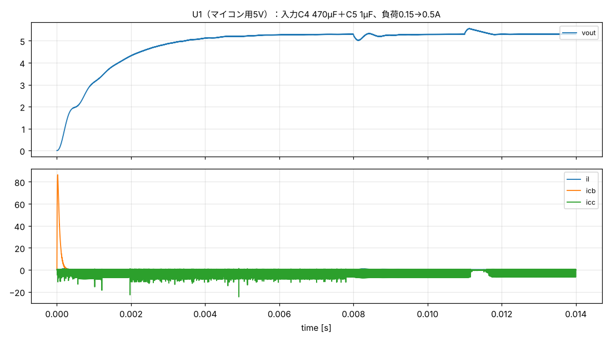

## tb8_u8  (tb8_buck_switching.cir)
U8（センサー用5VS）：入力C40 100µF＋C41 10µF（14Vで約3µF）、負荷0.3→0.7A

| check | value | limit | result | note |
|---|---|---|---|---|
| `abs(vout_avg-5.3)` | 0.00605 | < 0.15 | **PASS** | 出力電圧が5.3V±0.15V |
| `vout_pp` | 0.02366 | < 0.1 | **PASS** | 出力のリップル（ピーク間） [V] |
| `vout_min_step` | 4.983 | > 4.75 | **PASS** | 負荷が増えた瞬間の最低電圧 [V] |
| `vout_max_rel` | 5.596 | < 5.8 | **PASS** | 負荷が減った瞬間の最高電圧 [V] |
| `il_peak` | 1.011 | < 1.1 | **PASS** | インダクタ電流のピーク [A]（SWPA8040S101MTの飽和電流は要確認） |
| `icb_rms` | 0.2672 | < 0.3 | **PASS** | 電解コンデンサの入力リップル電流（実効値） [A]（目安0.3A、部品の定格は要確認） |
| `t_start*1000` | 3.464 | < 10 | **PASS** | 起動時間 [ms] |

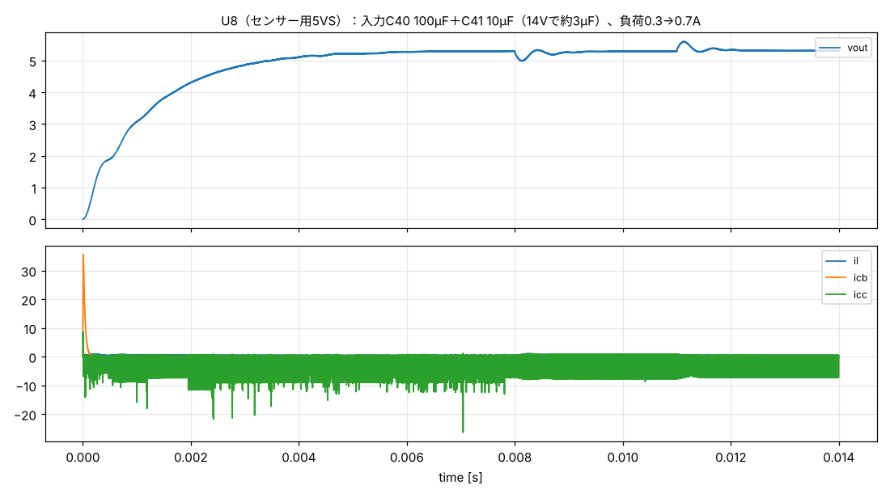

## tb9_100p  (tb9_i2c.cir)
I2C 400kHz：バス容量100pF（ケーブル短め）

| check | value | limit | result | note |
|---|---|---|---|---|
| `trise_ns` | 101.7 | < 300 | **PASS** | 立ち上がり時間（30→70%） [ns]（Fast-modeの上限300ns） |
| `scl_hi_end` | 3.3 | > 2.31 | **PASS** | 次の立ち下がりまでにHレベル（70%）に達する [V] |
| `sda_vol` | 0.2538 | < 0.4 | **PASS** | Lレベル（弱いデバイス、約3mA） [V]（上限0.4V） |

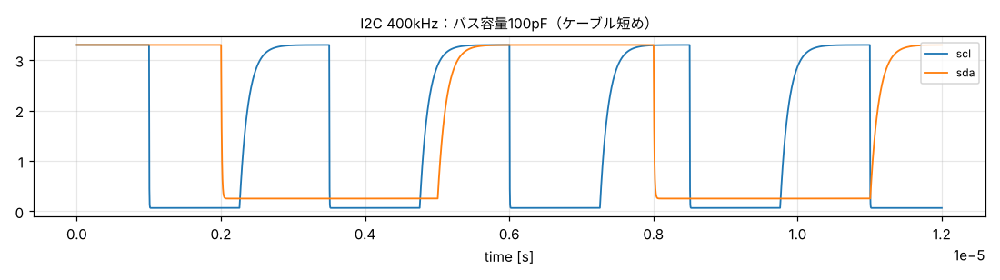

## tb9_200p  (tb9_i2c.cir)
I2C 400kHz：バス容量200pF

| check | value | limit | result | note |
|---|---|---|---|---|
| `trise_ns` | 203.4 | < 300 | **PASS** | 立ち上がり時間（30→70%） [ns]（Fast-modeの上限300ns） |
| `scl_hi_end` | 3.281 | > 2.31 | **PASS** | 次の立ち下がりまでにHレベル（70%）に達する [V] |
| `sda_vol` | 0.2538 | < 0.4 | **PASS** | Lレベル（弱いデバイス、約3mA） [V]（上限0.4V） |

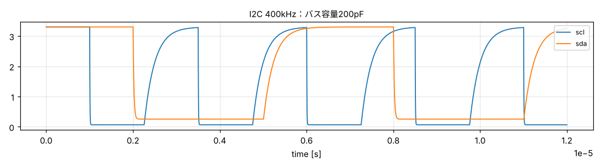

## tb9_250p  (tb9_i2c.cir)
I2C 400kHz：バス容量250pF（6ポートに約50cmずつ）

| check | value | limit | result | note |
|---|---|---|---|---|
| `trise_ns` | 254.2 | < 300 | **PASS** | 立ち上がり時間（30→70%） [ns]（Fast-modeの上限300ns） |
| `scl_hi_end` | 3.247 | > 2.31 | **PASS** | 次の立ち下がりまでにHレベル（70%）に達する [V] |
| `sda_vol` | 0.2538 | < 0.4 | **PASS** | Lレベル（弱いデバイス、約3mA） [V]（上限0.4V） |

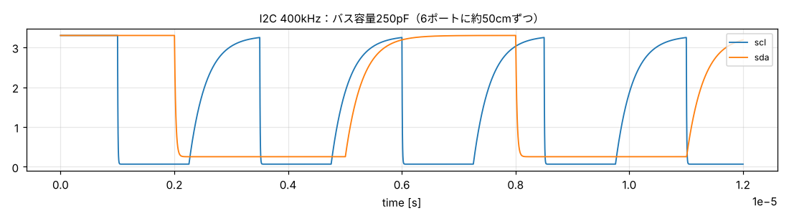

## tb9_200p_mod2  (tb9_i2c.cir)
I2C 400kHz：バス容量200pF＋センサー基板のプルアップ10k×2

| check | value | limit | result | note |
|---|---|---|---|---|
| `trise_ns` | 164 | < 300 | **PASS** | 立ち上がり時間（30→70%） [ns]（Fast-modeの上限300ns） |
| `scl_hi_end` | 3.294 | > 2.31 | **PASS** | 次の立ち下がりまでにHレベル（70%）に達する [V] |
| `sda_vol` | 0.3091 | < 0.4 | **PASS** | Lレベル（弱いデバイス、約3mA） [V]（上限0.4V） |

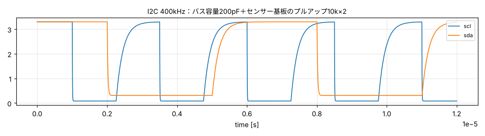

## tb9_400p  (tb9_i2c.cir)
I2C 400kHz：限界の確認：バス容量400pF

| check | value | limit | result | note |
|---|---|---|---|---|
| `trise_ns` | 406.7 | < 300 | **WARN** | 立ち上がり時間（30→70%） [ns]（Fast-modeの上限300ns） |
| `scl_hi_end` | 3.052 | > 2.31 | **PASS** | 次の立ち下がりまでにHレベル（70%）に達する [V] |
| `sda_vol` | 0.2538 | < 0.4 | **PASS** | Lレベル（弱いデバイス、約3mA） [V]（上限0.4V） |

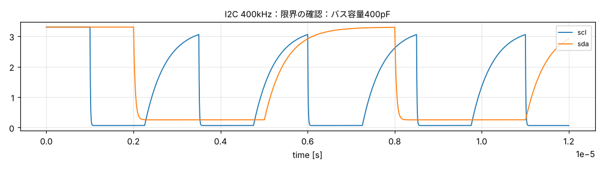

## tb9_200p_mod6  (tb9_i2c.cir)
I2C 400kHz：限界の確認：センサー基板のプルアップ10k×6

| check | value | limit | result | note |
|---|---|---|---|---|
| `trise_ns` | 118.3 | < 300 | **PASS** | 立ち上がり時間（30→70%） [ns]（Fast-modeの上限300ns） |
| `scl_hi_end` | 3.3 | > 2.31 | **PASS** | 次の立ち下がりまでにHレベル（70%）に達する [V] |
| `sda_vol` | 0.4134 | < 0.4 | **WARN** | Lレベル（弱いデバイス、約3mA） [V]（上限0.4V） |

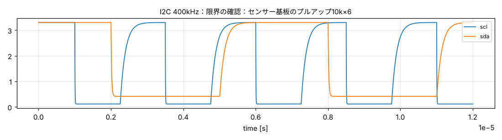

## tb10_rx  (tb10_can.cir)
CAN：500kbpsの受信

| check | value | limit | result | note |
|---|---|---|---|---|
| `vdiff_dom` | 2.081 | > 1.5 | **PASS** | ドミナントの差動電圧 [V]（1.5〜3.0V） |
| `vdiff_dom` | 2.081 | < 3 | **PASS** | ドミナントの差動電圧 [V] |
| `rxd_dom` | 0 | < 0.5 | **PASS** | RXDのL（ドミナント受信） [V] |
| `rxd_rec` | 3.3 | > 2.8 | **PASS** | RXDのH（レセッシブ） [V] |
| `ch_max` | 4.198 | < 58 | **PASS** | U6のCANHが+58V以下 [V]（TJA1042の絶対最大定格） |
| `ch_min` | 2.234 | > -58 | **PASS** | U6のCANHが−58V以上 [V] |
| `cl_max` | 2.759 | < 58 | **PASS** | U6のCANLが+58V以下 [V] |
| `cl_min` | 0.7994 | > -58 | **PASS** | U6のCANLが−58V以上 [V] |

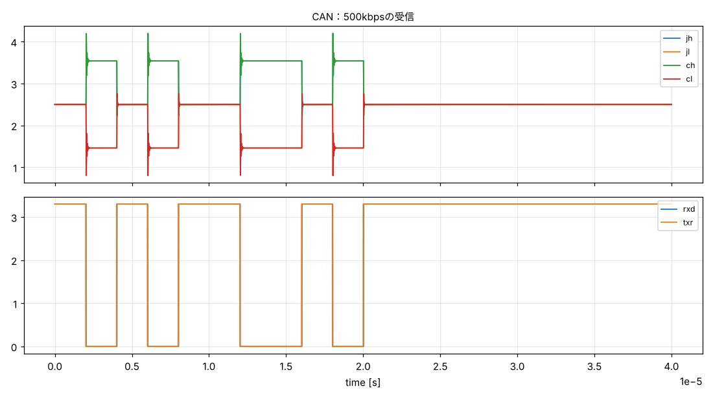

## tb10_short14  (tb10_can.cir)
CAN：CANHが14.4Vに短絡

| check | value | limit | result | note |
|---|---|---|---|---|
| `ch_max` | 23.4 | < 58 | **PASS** | U6のCANHが+58V以下 [V]（TJA1042の絶対最大定格） |
| `ch_min` | 2.234 | > -58 | **PASS** | U6のCANHが−58V以上 [V] |
| `cl_max` | 18.3 | < 58 | **PASS** | U6のCANLが+58V以下 [V] |
| `cl_min` | -3.26 | > -58 | **PASS** | U6のCANLが−58V以上 [V] |
| `ipesd_end` | 0.00095 | < 0.005 | **PASS** | 短絡が続いている間にJ3から流れ込む電流 [A]（PESD1CANが導通しない） |

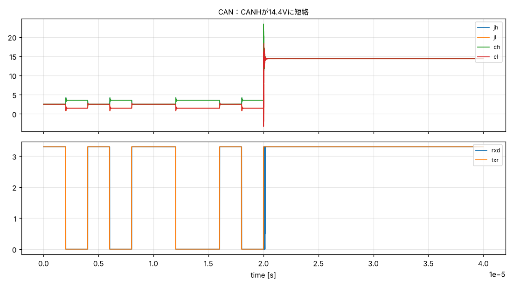

## tb10_short24  (tb10_can.cir)
CAN：CANHが24Vに短絡（24Vジャンプスタート）

| check | value | limit | result | note |
|---|---|---|---|---|
| `ch_max` | 41 | < 58 | **PASS** | U6のCANHが+58V以下 [V]（TJA1042の絶対最大定格） |
| `ch_min` | 2.234 | > -58 | **PASS** | U6のCANHが−58V以上 [V] |
| `cl_max` | 31.59 | < 58 | **PASS** | U6のCANLが+58V以下 [V] |
| `cl_min` | -7.455 | > -58 | **PASS** | U6のCANLが−58V以上 [V] |
| `ipesd_end` | 0.001716 | < 0.005 | **PASS** | 短絡が続いている間にJ3から流れ込む電流 [A]（PESD1CANが導通しない） |

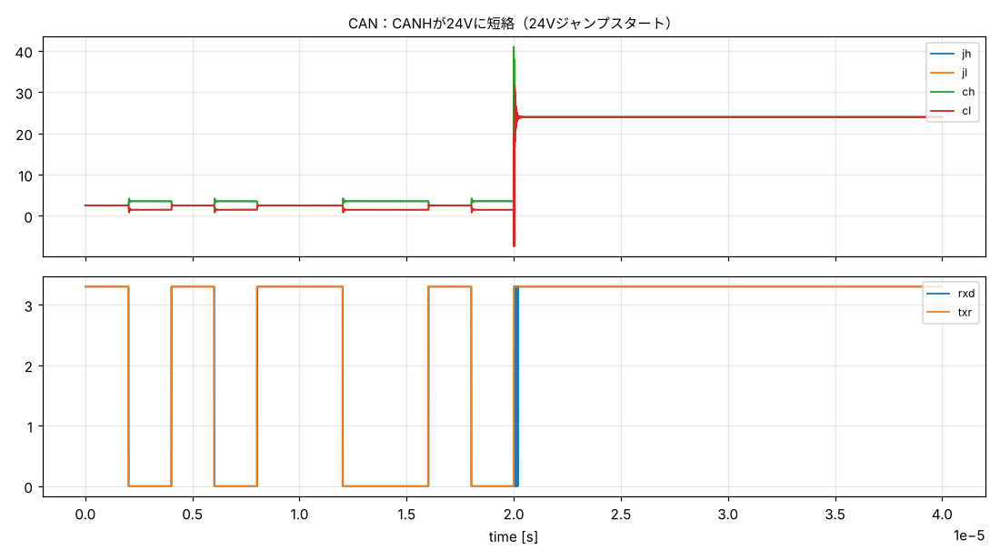

## tb10_pulse_a  (tb10_can.cir)
CAN：ISO 7637-3 パルスa（−150V）

| check | value | limit | result | note |
|---|---|---|---|---|
| `ch_max` | 28.49 | < 58 | **PASS** | U6のCANHが+58V以下 [V]（TJA1042の絶対最大定格） |
| `ch_min` | -32.64 | > -58 | **PASS** | U6のCANHが−58V以上 [V] |
| `cl_max` | 28.49 | < 58 | **PASS** | U6のCANLが+58V以下 [V] |
| `cl_min` | -32.63 | > -58 | **PASS** | U6のCANLが−58V以上 [V] |

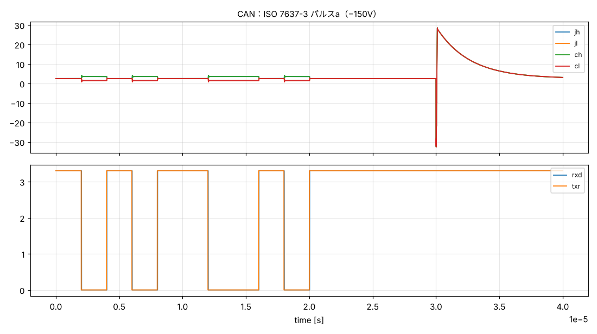

## tb10_pulse_b  (tb10_can.cir)
CAN：ISO 7637-3 パルスb（+100V）

| check | value | limit | result | note |
|---|---|---|---|---|
| `ch_max` | 31.1 | < 58 | **PASS** | U6のCANHが+58V以下 [V]（TJA1042の絶対最大定格） |
| `ch_min` | -15.22 | > -58 | **PASS** | U6のCANHが−58V以上 [V] |
| `cl_max` | 31.1 | < 58 | **PASS** | U6のCANLが+58V以下 [V] |
| `cl_min` | -15.23 | > -58 | **PASS** | U6のCANLが−58V以上 [V] |

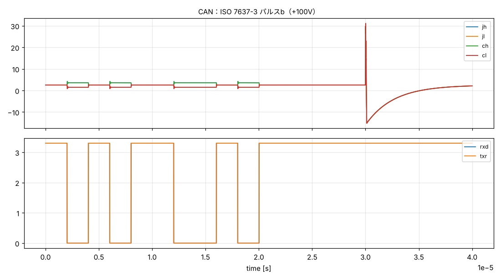

## tb11_12v  (tb11_gpio.cir)
GPIO保護（1kΩ）：ポートの信号ピンに12Vを誤配線（3.3Vの消費40mA）

| check | value | limit | result | note |
|---|---|---|---|---|
| `v3_max` | 3.298 | < 3.6 | **PASS** | XIAOの3.3Vが上がらない [V]（ESP32-S3の絶対最大3.6V） |
| `ipin_max*1000` | 8.068 | < 10 | **PASS** | ピンに流れ込む電流 [mA]（目安10mA以下） |
| `trise_ns` | 16 | < 1000 | **PASS** | 通常使用：受信側（GPSのTX→XIAO）の立ち上がり [ns] |
| `trise_tx_ns` | 235 | < 271 | **PASS** | 通常使用：送信側（XIAO→ケーブル100pF→GPSのRX）の立ち上がり [ns]（921600bpsの1ビットの25%） |

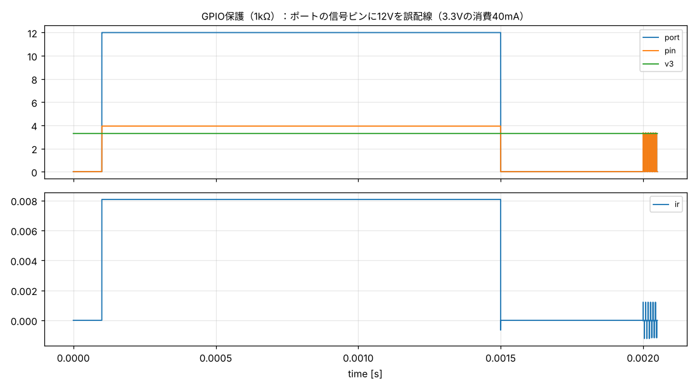

## tb11_25v  (tb11_gpio.cir)
GPIO保護（1kΩ）：25V（ロードダンプ時のVSW_EXT）

| check | value | limit | result | note |
|---|---|---|---|---|
| `v3_max` | 3.299 | < 3.6 | **PASS** | XIAOの3.3Vが上がらない [V]（ESP32-S3の絶対最大3.6V） |
| `ipin_max*1000` | 21 | < 10 | **WARN** | ピンに流れ込む電流 [mA]（目安10mA以下） |
| `trise_ns` | 16 | < 1000 | **PASS** | 通常使用：受信側（GPSのTX→XIAO）の立ち上がり [ns] |
| `trise_tx_ns` | 235 | < 271 | **PASS** | 通常使用：送信側（XIAO→ケーブル100pF→GPSのRX）の立ち上がり [ns]（921600bpsの1ビットの25%） |

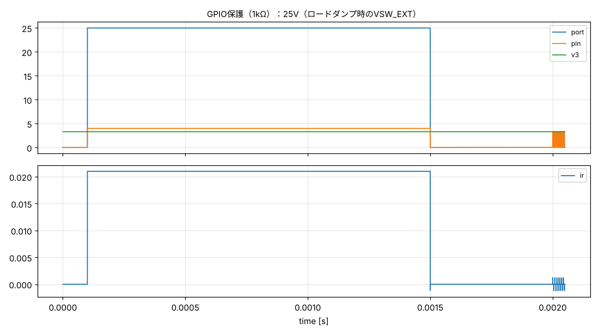

## tb11_12v_sleep  (tb11_gpio.cir)
GPIO保護（1kΩ）：参考：12V・マイコンがスリープ中（3.3Vの消費5mA）

| check | value | limit | result | note |
|---|---|---|---|---|
| `v3_max` | 3.674 | < 3.6 | **WARN** | XIAOの3.3Vが上がらない [V]（ESP32-S3の絶対最大3.6V） |
| `ipin_max*1000` | 8.036 | < 10 | **PASS** | ピンに流れ込む電流 [mA]（目安10mA以下） |
| `trise_ns` | 16 | < 1000 | **PASS** | 通常使用：受信側（GPSのTX→XIAO）の立ち上がり [ns] |
| `trise_tx_ns` | 235 | < 271 | **PASS** | 通常使用：送信側（XIAO→ケーブル100pF→GPSのRX）の立ち上がり [ns]（921600bpsの1ビットの25%） |

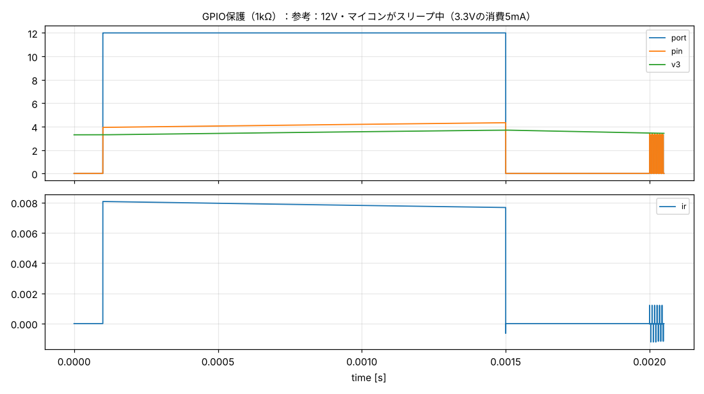
